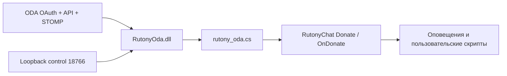

# Архитектура и данные

`RuntimeHost` создаёт `BridgeService` и `BridgeServer`. Тонкий скрипт
загружает только `RutonyOda.dll` и вызывает публичный native Donate.
`BridgeService` координирует настройки, статус и барьер остановки.
`OAuthCoordinator` владеет одноразовой PKCE-попыткой, отменой входа/refresh
и границей сохранения credentials. `StompConsumer` владеет WebSocket,
переговорами, heartbeat и ACK; `DeliveryTransaction` проверяет событие,
фильтры и выполняет prepared → native → committed. Transport отправляет
ACK только после успешного возврата транзакции. Эти компоненты внутренние;
публичные методы BridgeService и reflection-контракт RuntimeHost прежние.

Скрипт передаёт явный HTML anchor **Открыть панель ODA** через
`RutonyBot.SayToWindow`. Href строится только из loopback и проверенного
порта; текст и адрес HTML-экранируются. В подписи нет URL, поэтому тема
с autolink не создаёт вложенную ссылку по тексту подписи. Legacy default
показывает готовый HTML, пользовательские темы могут обрабатывать его
иначе. Private UI layout RutonyChat не изменяется. У моста собственный
жизненный цикл и пакет.

## Жизненный цикл в RutonyChat

RutonyChat может вызывать InitParams и Closing в потоке интерфейса.
Синхронная reflection-граница RuntimeHost выполняет запуск и полную
очистку через Task.Run без UI SynchronizationContext. Вызывающий поток
дожидается результата: Closing завершается после остановки HTTP,
завершения текущей работы и закрытия файлов. Фоновая незавершённая
очистка после возврата из Closing не оставляется.

Остановка сначала отменяет OAuth, затем ждёт управляющий барьер и worker.
Поэтому зависший успешный ответ token endpoint не удерживает Closing.
Отмена и запись credentials синхронизированы: результат отменённого входа
или refresh не сохраняется позднее. После начала остановки новые управляющие
операции отклоняются. Уже начатая native-доставка по-прежнему завершается
до освобождения журнала; отмена не разрывает prepared → publish → commit.

Это предотвращает взаимное ожидание UI и async continuation при изменении
или удалении пресета. Повторный запуск использует прежние данные и
освободившийся порт. Долгое стороннее событие или сбой диска всё ещё
может задержать завершение; цикл жизни в настоящем RutonyChat проверяется
отдельным ручным прогоном.

## OAuth и управление

Пользователь указывает Client ID/Secret собственного приложения ODA.
Вход — Authorization Code + PKCE S256 и случайный одноразовый state
с ограниченным сроком. Redirect — `http://127.0.0.1:18766/oauth/callback`
либо выбранный порт. Scopes — `stomp offline_access`. Access token служит
API и STOMP; `id_token` не является локальной аутентификацией.
Token HTTP client не следует редиректам. Общий deadline HTTP-операции —
20 секунд, включая чтение успешного JSON body; диагностика ошибочного body
дополнительно ограничена двумя секундами. Проверка и создание подписки
разделяют один deadline. Остановка может отменить операцию раньше.
Production endpoints фиксированы;
тестовые endpoints допускают только loopback.

HTTP слушает только IPv4 loopback. Занятый порт останавливает запуск.
Управляющие POST требуют JSON, локальный токен и корректные Host/Origin.
OAuth callback проверяет state/PKCE. Секреты не возвращаются состоянием
панели и не попадают в URL управления или журнал доставки.

API проверяет собственную подписку клиента `GET /subscriptions` и создаёт
недостающий HistoryItemEvent через `POST /subscriptions/commands/add-queue-subscription`.
Чужие подписки не изменяются. STOMP WSS — `wss://api.oda.digital/ws`,
passcode — access token, destination — `/exchange/subscriptions/{clientId}`.
Маршрут соответствует publisher routing key и RabbitMQ exchange contract.
Права доступа конкретного OAuth-приложения и обработку отказов ODA
нужно проверять отдельно: локальные имитаторы не воспроизводят все
production ACL и ограничения сервиса.

Очередь отдельная для установки/клиента: durable, `exclusive=false`,
`auto-delete=false`, TTL 24 часа, manual client-individual ACK и prefetch=1.
CONNECT не подменяет default vhost DNS-именем. Есть refresh и reconnect
с ограниченной экспоненциальной задержкой. Пауза дожидается начатого
native-вызова и отключает consumer.

После WebSocket upgrade CONNECT и SUBSCRIBE имеют отдельные абсолютные
15-секундные deadlines, которые heartbeat и фрагменты ответа не продлевают.
После подтверждения подписки действует согласованный heartbeat watchdog.
Декодер потребляет каждый байт один раз, сохраняет только текущие строку/body,
поддерживает LF/CRLF, escaping и NUL внутри content-length body. Лимиты:
16 KiB на заголовочную часть, 64 заголовка, 1 MiB на body; UTF-8 заголовков
проверяется строго, UTF-8 события проверяет транзакция доставки.

Квоты брокера задаёт ODA: отсутствие потерь при внешних ограничениях и полный импорт истории не обещаются.

## Native и совместимость идентификаторов

Принимаются `payment` выбранных `SourceSystems`; отсутствие поля в старых
настройках означает только ODA. Сумма — `major + minor/100`, minor 0..99.
Сохраняется валюта. Сумма, которую native float меняет до копейки, отклоняется.
Скрипт разбирает сумму с InvariantCulture, включая запуск под ru-RU.

Native-вызов — семиаргументный `ChatEventServer.Donate`: `SiteEnum.other`,
имя, `SumClass(float, CurrencyItem { CharCode })`, текст, `test=false`,
пустой voice и `message_id="oda:" + key`. Стандартный UI может назвать
сервис Other. Global site tables и чужие настройки не изменяются.

Ключ ODA сохраняет прежний `recipientId/originId`, при отсутствии originId
используется id. Импортированные системы имеют ключ `imported:SHA-256`
от однозначно закодированных system/recipient/id. Legacy ODA ID содержат
`/`, поэтому пространства не пересекаются. Повторяющиеся имена при разных
ID сохраняются. Новые skip fingerprints — `invalid:hash`; чтение прежних
`invalid/hash` сохраняется. Разделение репозитория не меняет эти форматы.

## Файлы и восстановление

По умолчанию данные находятся в `LocalAppData/RutonyOda` текущего пользователя
Windows, отдельно от пакета. Параметр скрипта `DataDirectory` переопределяет
этот каталог; `PackageDirectory` задаёт место DLL/web. Смена DataDirectory
создаёт другую историю и install ID, поэтому не служит сбросом ошибки.

| Файл | Содержание |
|---|---|
| `settings.json` | `Enabled`, `InstallationId`, `SourceSystems` — передача, ID установки, выбранные галочки |
| `credentials.bin` | Client ID/Secret, refresh/access token и срок; DPAPI текущего Windows-пользователя |
| `deliveries.jsonl` | ID, этап и время записи доставки/явного решения; без полных payload и текста доната |
| `ledger.version`, `ledger.initialized` | Маркеры формата и инициализации журнала |

Сам файл `deliveries.jsonl` открывается с FileShare.Read: второй writer
не может открыть его одновременно. Отдельного lock-файла нет.

`settings.json` не является хранилищем OAuth. Копирование `credentials.bin`
другому Windows-пользователю не переносит возможность расшифровки DPAPI.
Обновление пакета не меняет рабочие файлы. При сохранении нового приложения
передача выключается и требуется новый вход; смена источников сохраняет OAuth.

Порядок доставки: durable `prepared` → native-вызов → `committed` → ACK.
Committed ID повторно не публикуется. Prepared без committed означает
неопределённый результат: оператор подтверждает доставку либо разрешает
повтор, который может повторить оповещение. Exactly-once между файлом
и native API не гарантируется.

Ошибки Write/Flush блокируют текущий экземпляр журнала, включая Enable,
Resolve и Skip: запись могла достичь диска до ошибки. Продолжение требует
переоткрытия и проверки без удаления данных. Повреждение/пропажа уже
инициализированного журнала также блокирует передачу. Некорректное сообщение
ставит мост на паузу; явный Skip сохраняет SHA-256 отпечаток без payload.

[Публичные основания API](../research/oda-contracts.md) · [Качество](quality.md)
